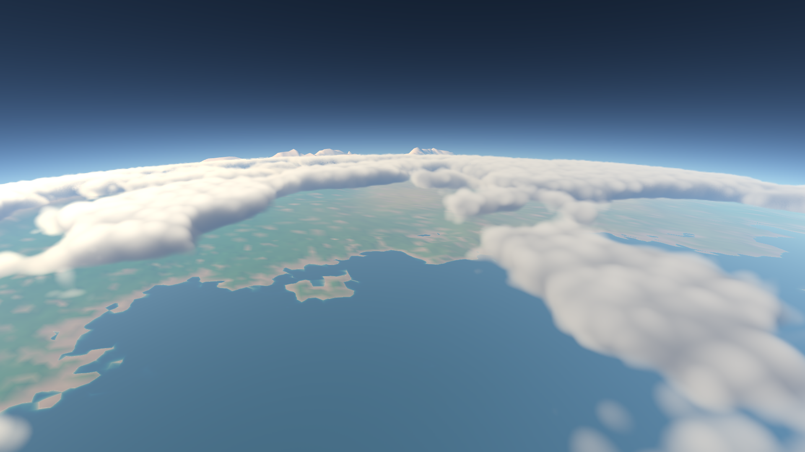
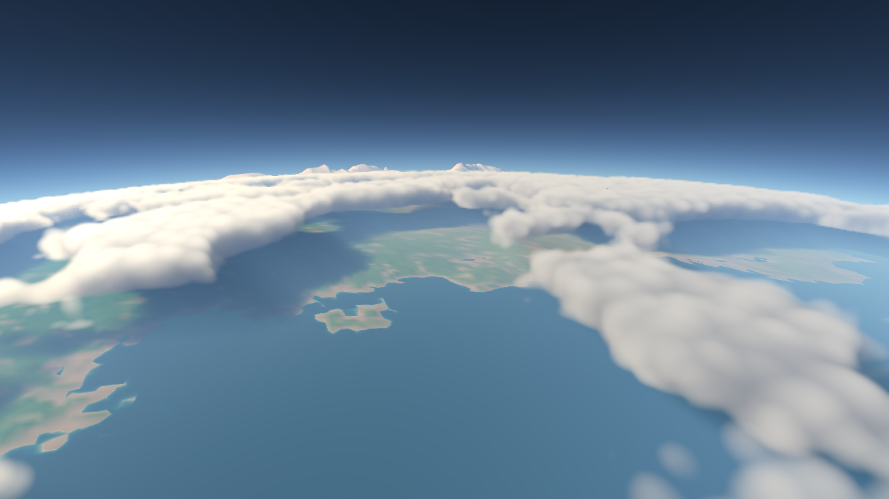

# Spherical volumetric clouds

Clouds are enabled by default. **C** toggles clouds and clear air; **F** disables
both atmosphere and clouds. The field is seeded with the planet, follows its
curvature, and supports cameras below, inside, or above the layer. Moving cloud
shadows share this density field and wind clock, dimming direct sunlight on
terrain, water and atmospheric haze.

Nearby water also samples this cloud field through a sea-level reflection
cache. The underwater sky window uses it too, while the separate visible cloud
pass remains disabled underwater. See [water lighting](water-lighting.md) for
the curvature correction, filtering, costs and limitations.



## Controls

```powershell
# Normal launch, including clouds
.\bin\universebuild.exe
# More GPU headroom; quarter width and quarter height
.\bin\universebuild.exe -cloud-scale=0.25
# Coverage: 0 is clear, 1 is the densest setting
.\bin\universebuild.exe -cloud-coverage=0.7
# Clear-air reference
.\bin\universebuild.exe -clouds=false
# Keep visible clouds but disable their cast shadows
.\bin\universebuild.exe -cloud-shadows=false
# Compare the original display response, including clipped highlights
.\bin\universebuild.exe -tonemap=linear
# Adjust fixed exposure without changing the cloud density or sunlight
.\bin\universebuild.exe -exposure=0.8
```

`-cloud-scale` accepts 0.25, 0.5 (default), or 1. Coverage defaults to 0.52.
The layer lies 2.2–5.2 km above the configured sea level and rotates around the
polar axis at about 15 m/s at the equator. It uses the continuous simulation
clock, not the short looping water clock. `-air-passes=false` disables clouds
as well; that option retains the inline clear-air reference.

The default `-tonemap=filmic` uses the engine's ACES display curve at fixed
`-exposure=1`. It rolls off bright cloud rims after the complete HDR scene has
been composed, preserving shading that the previous linear resolve clipped to
white. It also changes terrain, sky and water contrast, including when clouds
are disabled. `-tonemap=linear -exposure=1` restores the original display
response. Exposure is a positive multiplier up to 16, with no automatic
adaptation. Caustic debug views retain the original linear response at exposure
1 so their intensity scale remains meaningful. UI is composited after tone
mapping. This uses the existing engine resolve, adding no passes or targets.

The earlier screen-space sun shafts do not run in cloud mode: they execute
before cloud composition and have no cloud visibility. Physical view scattering
uses the existing terrain-shadow visibility and cloud extinction. A compact
optical sun glow and soft burst are added **after** cloud composition, before
tone mapping. **R** / `-sun-rays=false` controls this glare, the extra clear-air
screen-space effect, and underwater shafts.

The cloud composite stores direct solar luminance in its otherwise unused alpha
channel. Terrain depth, the solid planet and analytic ocean reject the source;
RGB cloud/air transmission attenuates it. The existing present pass averages 32
fixed samples over the visible disc and applies a bounded angular glare profile.
The corona stays close to the disc. Four faint diffraction axes have unequal
widths and decay lengths, blending into the corona instead of forming a bright
six-point silhouette against dark high-altitude sky. Their cross-sections narrow
away from the disc; a fixed azimuth would widen into a V with distance. The
previous broad halo tail is removed so the optical effect does not bleach a
large patch of sky. The `sun-high` capture pose checks the high-contrast case
alongside the hazier coastal `sun-burst` view.
This is an optical display effect, separate from volumetric scattering. Bright
cloud rims and water reflections cannot create a false sun burst. Partial disc
occlusion fades its strength; a fully hidden sun produces none. Source hue is
estimated from the composed solar pixels, with luminance fixed by the direct
source mask. Sampling is limited to the visible screen, so glare fades as the
disc leaves the frame. There is no temporal history, extra pass or extra target.
The present pass also checks the destination against terrain depth, the solid
planet and analytic water. A partly exposed sun cannot paint the artistic
corona onto a mountain in front of it. This sky-only mask does not affect the
volumetric light integrated between the camera and terrain.

`TestSunGlareOcclusionGPU` exercises the production composite/present shaders
with clear, thin and opaque clouds, bright opaque foreground/cloud pixels,
half-disc occlusion (including zero flare on the opaque half), solid-planet and ocean blockage, toggles and target
recreation. Projection checks cover portrait through ultrawide views and a sun
behind the camera. Reproduction captures are under `captures/sun-glare`.
Flare-shape comparisons use the centered `sun-burst` capture preset under
`captures/sun-burst-shape`, including an R-off reference to separate the optical
effect from the existing atmospheric glow.
GPU timing comparisons for this change are deferred while a local LLM shares
the GPU; no performance delta is claimed.

Cloud shadows are enabled by default. **H** disables them together with terrain
shadows; **C** or **F** also disables them. Broad cloud shading stays active
underwater even though hard local shadows and the visible cloud pass normally
turn off there. This keeps sunlight consistent when crossing the waterline.

## Integration

The view ray intersects a spherical shell. The hollow inner sphere is subtracted
from the outer sphere, including both shell segments for grazing orbital views.
Opaque scene depth and the nearer analytic ocean intersection limit the ray.
This keeps clouds behind visible terrain and ends air at the water surface.

One compute pass integrates air and clouds together in depth order. It uses
Beer–Lambert transmission, a forward/backward scattering phase mixture, five
cloud sunlight samples, and a bounded approximation to multiple scattering.
The atmospheric sunlight table supplies wavelength-dependent sun attenuation;
terrain shadow maps can shade the cloud volume. Clear-air segments before,
between and after the shell reuse the existing atmospheric integrator.

The march uses at most 96 samples per shell segment, with more samples near the
eye and an early exit for near-zero transmission. Each interval samples its full
width using spatial interleaved gradient noise, with the orientation and phase
varied between steps. The former shared offset covered only the middle 60% of
each interval, leaving gaps that appeared as fine horizontal bands in cloud
bodies at grazing angles. Sample positions remain fixed per output pixel and
step, so a frozen scene does not receive a new noise pattern every frame.
There is no temporal accumulation or reprojection yet.

Cloud shape, cellular erosion and large-scale coverage come from a seeded
64³ RGBA8 noise volume, uploaded with `CreateTexture3D`. Linear filtering and
repeat addressing on X, Y and Z provide native trilinear sampling. All seven
mip levels retain the same explicitly rounded 2×2×2 box means as the original
atlas; the seeded field has not changed. A single `textureLod` blends neighboring
volume mip levels according to the ray footprint and integration interval.
This replaces two to four atlas reads and their slice/gutter coordinate math.
The view march, cloud-shadow integration and water sky cache share this volume;
each declares its volume input with the engine's `Reads3D` contract.

The compute pass writes radiance plus endpoint distance and RGB transmission
to two reduced-resolution RGBA16F targets. The existing depth-aware atmospheric
reconstruction produces `scene * transmission + radiance` in linear HDR.
Cloud mode uses a small 3×3 spatial filter to average the distributed sampling
error. It filters radiance and RGB transmission together, with endpoint-depth
weights to reject samples across foreground silhouettes; it does not blur the
underlying scene color. Clear-air mode retains four-tap bilinear reconstruction.
Cloud and clear-air modes share the full-resolution output and presentation
pass. At 3840×2054, the default cloud targets add about 30.1 MiB. The noise volume
contains 1.14 MiB of texel data, down from the atlas's 1.46 MiB; device allocation
alignment may add overhead. Resources remain allocated while C switches modes.

## Cloud shadows

A compute pass builds a sun-aligned transmittance field before scene lighting.
The 512×512 RGBA16F atlas uses 2 MiB and contains four 256×256 tiles: a local
128 km projection and a whole-planet projection, each with separate near and
far shell lobes. Each tile integrates cumulative optical depth at four heights
along its lobe and stores the corresponding transmitted sunlight. Spatial
filtering and the local/global coverage blend average this light. Interpolation
along a ray remains in optical depth, preserving Beer–Lambert attenuation.
Mountains above a cloud remain sunlit; receivers inside it receive partial
attenuation. The empty interior between shell lobes contributes no extinction.

The local projection snaps to complete 500 m texels and blends into the global
projection before its edge. Coordinates are planet-relative, independent of
render-origin rebasing. Bilinear samples stay inside their atlas tile; the
density integral also filters the noise to the sample footprint. Coverage,
layer heights and wind parameters are identical to those of the visible clouds.

Terrain, ocean glints, foam, seabed sunlight and caustics receive this visibility.
Air scattering samples it along the view ray; underwater shafts use one sample
along their short integration path. The visible clouds retain their existing
sunlight march for self-shadowing, avoiding applying the cached extinction twice
to cloud lighting.

Surface lighting also approximates diffuse light transmitted through clouds.
Previously, blocking the direct beam left only the small clear-sky ambient term,
making overcast terrain almost black. For beam transmission `T`, the diffuse
fraction is `1 / (1 + 0.18 * tau) - T`, where `tau = -log(T)` with a numerical
floor at `1e-7`. It uses the clear atmospheric sunlight, local sun elevation and
the surface's exposure to the upper hemisphere. Direct plus diffuse transmission
on a horizontal surface stays at or below the clear-sky value. Thicker clouds
still transmit less total light, and the added term vanishes at night, in clear
sunlight, above the cloud layer, or when cloud shadows/atmosphere are disabled.
Terrain, rocks, foliage, seabed diffuse lighting and shoreline foam share it;
underwater diffuse attenuation still applies. It does not brighten direct glints,
caustics, sun glare or volumetric rays through opaque clouds.

This is a bounded surface multiple-scattering approximation, not a hemispherical
sky integration or a full cloud transport solve. It uses the existing shadow
lookup and adds no textures, passes or cloud ray marches. The `cloud-shade` pose
and `ground` at `--coverage 0.8` exercise shaded terrain in capture checks.

Matched 1280×720, fixed-frame captures in `captures/cloud-light-balance` show
the overcast ground lift while the clear-sun `ground` and `night` views remain
pixel-identical. High-altitude and coastal sun views, low-sun foothills and an
overcast underwater view were inspected. The cloud-shadow optical-depth and
filtering tests, air-shadow sampling, cloud/water lifecycle and sun-occlusion GPU
checks pass with synchronization validation. GPU timing comparisons are deferred
while another workload shares the device.

Clear-air integration averages joint terrain and cloud visibility at the same
stratified positions within each interval. Sampling cloud shadows only at the
interval midpoint caused repeated horizontal bands beneath distant cloud banks.
This uses the existing one-to-four visibility samples per interval, with fixed
spatial jitter; the 16 atmospheric intervals and cloud march budget are unchanged.
It adds cloud-field lookups along long rays, without adding passes or history.



### Mountain shadow wedges (2026-10-13)

Repeating dark wedges across a mountainside were reproduced in the isolated
cloud-shadow mask. The terrain-shadow mask did not contain that row of wedges.
The previous cache stored optical depth, applied bilinear filtering, and then
exponentiated the result. At a boundary between opaque and clear cloud columns,
this turns a half-covered footprint nearly black rather than transmitting half
the sunlight. It exposes the projection grid as pointed dark lobes.

The cache now exponentiates each ray's integrated depth before storage. The same
hardware bilinear lookup then filters transmitted light correctly. Partial-lobe
receivers interpolate logarithms of the filtered knots; complete lobes read the
last knot directly. Near and far shell transmissions multiply, while the
local/global coverage blend averages light. Atlas size, integration samples,
texture fetch count, render passes and cloud density are unchanged. The 500 m
local texels still limit shadow detail.

`TestCloudShadowFilteringGPU` drives the production compute shader with adjacent
opaque/clear columns and checks 16,384 receiver positions in both projections
against an independent area-weighted light sum. The old filtering fails all
16,384 samples; the new filtering passes. The homogeneous-extinction regression
also verifies partial rays against analytic transmission, including inside,
above, below and opposite-side receivers. Cloud and terrain-shadow GPU tests
pass with Vulkan synchronization validation enabled.

The reproduction uses seed 7, erosion, longitude 53.5, latitude 8.4, altitude
1000 above terrain, flight heading 100, pitch 12, and fixed frame 601. The view
volume is hidden only in diagnostic captures to expose the shadowed slope.
Scripts, masks and before/after images are in the ignored
`captures/shadow-bands` directory. This is a matching reproduction, not a saved
camera pose from the user's screenshot.

Matched RX 7900 XTX measurements at 3840×2054, 4× MSAA and half-resolution
clouds show no measured performance regression. Values are median window means
in milliseconds:

| View | Total GPU before / after | Shadow producer before / after |
| --- | ---: | ---: |
| Ground | 5.619 / 5.550 | 0.362 / 0.363 |
| Inside cloud layer | 10.572 / 10.548 | 0.364 / 0.365 |
| Cloud horizon | 10.895 / 10.710 | 0.340 / 0.340 |

Each view has two runs per build in before/after/after/before order, 1,201 frames
per run, a 720-frame warmup and eight complete 120-frame measurement windows per
build. Camera, terrain, vegetation and submission counts match. VSync, validation
and screenshots were disabled for timing; separate ground, coast, inside-cloud
and underwater captures passed Vulkan validation. The small total differences
are treated as run variation, not a general speedup. Raw measurements and the
comparison script are under `captures/shadow-bands`.

## Performance and validation

### Display highlight rolloff (2026-10-16)

The identity display resolve clipped HDR cloud rims even though their radiance
was preserved in the half-float cloud and scene targets. The default now selects
the engine's existing ACES curve at exposure 1. Cloud density, scattering,
self-shadowing and view sampling are unchanged; the curve is applied once to
the complete scene, after HDR composition. It adds no passes or texture memory.

Matched seed-7, frame-601 captures at 1600×900 show the following percentages
of pixels with at least one output RGB channel equal to 255:

| View | Original linear resolve | Filmic resolve |
| --- | ---: | ---: |
| Ground | 0.6101% | 0.0000% |
| Coast | 5.1816% | 0.0169% |
| Cloud horizon | 7.2305% | 0.0281% |
| Above cloud layer | 2.4083% | 0.0000% |

These are display saturation measurements over the full image, not cloud-only
error estimates. Sun cores may still saturate. Ground, coast, mountains, cloud
horizon, inside/above-layer, orbital, night and underwater captures passed
Vulkan validation and were visually checked. Evidence is under the ignored
`captures/cloud-lighting` directory.

The final `-tonemap=linear -exposure=1` coast capture is pixel-identical to the
pre-change reference. Caustic debug captures are also identical when launched
with either display curve (including a non-default requested exposure), and
their profiles report the effective linear curve at exposure 1. Invalid curve
names and non-positive, non-finite or unrepresentable exposure values are
rejected before renderer startup. Go tests and vet pass.

Use `tools/capture_clouds.py --tonemap linear` for the old display response.
JSONL profiles now record `Tonemap` and `Exposure`; `tools/profile_scene.py`
offers `clouds-linear` and `clouds-filmic` for matched comparisons. The initial
alternating 4K timing run had competing GPU work and large baseline variation,
so it is not evidence of a performance improvement or regression. Repeat it
on an otherwise idle GPU before assigning a cost to the curve:

```powershell
python tools/profile_scene.py --scenes ground coast cloud-horizon --variants clouds-linear clouds-filmic --repeats 2 --warmup 720
```

### Cloud rendering costs

The HUD/JSONL report `cloud volume`, `cloud composite`, `cloud shadows` and shared
`air present` GPU times, plus requested/active cloud and cloud-shadow modes,
coverage and scale. Before cast shadows were added, on the
RX 7900 XTX at 3840×2054, matched half-resolution comparisons added about
1.12 ms on land, 1.29 ms at the coast and 3.24 ms in an orbital terminator view.
See [rendering performance](rendering-performance.md#first-cloud-layer-2026-10-09)
for the complete method, totals and quarter-resolution results.

With clouds already visible, adding cast shadows costs about **0.40–1.40 ms**
in four fixed views at 3840×2054 on that GPU. This includes the producer and all
consumer lookups, not just the atlas dispatch. See the
[cloud-shadow comparison](rendering-performance.md#cloud-shadows-2026-10-09)
for matched totals and reproduction settings. These are fixed-view measurements,
not a maximum cost across the world.

The later fix for horizontal cloud-shadow bands in haze adds **about 1.7 ms** in
three matched 4K views, including extra lookups in water reflections. See the
[haze sampling comparison](rendering-performance.md#cloud-haze-banding-2026-10-13)
for the current measurements and regression evidence.

The subsequent fix for fine bands within the clouds retains the 96-step budget.
Its reconstruction adds about **0.2–0.4 ms** in two matched 4K views, with total
cost approximately unchanged in the cloud-height view. See the
[cloud-body sampling comparison](rendering-performance.md#fine-cloud-body-bands-2026-10-13)
for measurements, reproduction settings and the rejected dense-march option.

```powershell
go generate ./atmosphere
go test ./...
go vet ./...
$env:PLANET_GPU_TEST = '1'
$env:GLYPHENGINE_SYNC_VALIDATION = '1'
go test ./atmosphere -run '^TestCloud' -count=1
Remove-Item Env:PLANET_GPU_TEST
Remove-Item Env:GLYPHENGINE_SYNC_VALIDATION
go build -o bin/universebuild.exe .
python tools/capture_clouds.py --scenes ground cloud-horizon coast inside above orbit night --output captures/cloud-check
```

GPU regression checks exercise the production native volume upload and sampler
across negative coordinates, exact wrap seams on every axis, all seven mip
levels, fractional LODs and footprint clamping. Seed-7 hashes extracted from
the previous atlas pin every level's data. Checks also cover spherical
entry/exit and terrain clipping, mode
toggles, target recreation, and a dispatch smaller than the live target.
Cloud restoration matches a frozen reference within one 8-bit channel level.
The shadow GPU fixture runs the production integrator with constant density and
checks its result against analytic path lengths, including inside/above-cloud
receivers, both lobes, atlas edges and disabled shadows. Lifecycle checks update
the shadow producer while switching modes and resizing targets.
The haze regression replaces the external cloud-visibility field with translated
analytic shadow bands and compares the production integrator with a dense
1,024-interval reference. Averaging independently jittered rows isolates coherent
banding from spatial sampling noise; the former midpoint lookup fails this check.
The cloud-view sampling regression runs the production march in a homogeneous
medium with a translated analytic lighting field, compared against 4,096 uniform
reference intervals. It checks radiance bias after averaging independent rows
and exact Beer–Lambert transmission. The old bounded offset fails the radiance
check; the current spatial sampling passes without increasing the march budget.
Validation captures cover day/night, coastal water and inside/above-layer views.
The 3,600-frame descent/ascent tour passed Vulkan validation and confirmed
clouds disable underwater and restore above water. A fixed underwater comparison
with clouds requested on/off was pixel-identical before cast shadows were added.
At zero cloud coverage, the
ground comparison against clear air differed by 0.134/255 mean RGB (99th
percentile 1/255); sparse silhouette differences remain from reconstruction.

## Current limits and next work

- Cached cast shadows resolve broad formations: 500 m local texels and four
  transmittance knots per lobe smooth small features and vertical density changes.
  The global projection is coarser still. These are filtered approximations,
  not per-receiver cloud ray tracing. Mountains can shade clouds within the
  existing terrain shadow-map coverage.
- The water sky cache uses one representative cloud height for parallax and
  fades back to clear air across 8–32 km from its origin. It cannot reproduce
  exact thick-volume parallax at distant receivers or reflect nearby geometry.
- The single fixed layer has fairly soft, broad formations. Sun-facing edges can
  still be bright after the filmic highlight rolloff, and spatial sampling grain
  can remain in thin clouds,
  especially at quarter resolution.
  Thin silhouettes use the existing clear-air reconstruction
  fallback when no depth-compatible cloud sample exists. Density shaping,
  finer silhouettes and quality during fast motion need further refinement.
- Multiple scattering and ambient cloud illumination are approximations. This
  is not a weather simulation or a full radiative-transfer solution.
- A later temporal path must account for camera rebasing, moving clouds, changing
  depth/visibility, water crossings and resize. History allocation alone is
  insufficient; retain this non-temporal path as a reference.

The engine dependency pins `af525925956a`, including the shared sampler/timer
capacities from [PR #193](https://github.com/derekmwright/glyphengine/pull/193),
frame-fenced instance staging from [PR #197](https://github.com/derekmwright/glyphengine/pull/197),
and application pipeline statistics from [PR #198](https://github.com/derekmwright/glyphengine/pull/198).
The showcase requests seven shared sampler slots and 32 application timers;
27 timers are registered with all effects enabled. The cloud-shadow field
occupies slot 4 (binding 11), and water sky radiance/transmission use slots 5–6.
[Request #190](https://github.com/derekmwright/glyphengine/issues/190) for native
sampled 3D textures is now adopted by all three cloud-density consumers. It adds
no rendering passes or temporal state. At 1280×720 and fixed frame 361, matched
coast, cloud-horizon and above-layer captures differ by at most 1/255 in any RGB
channel; mean differences are 0.00066, 0.00594 and 0.00134/255 respectively.
Inside-layer, orbital and underwater sky-window views also passed visual checks.
The full atmosphere GPU suite passed with synchronization validation enabled.
Captures and logs live under `captures/cloud-native3d`; GPU speed comparisons
are deferred while the local LLM shares the device.

Method references include Guerrilla's
[The Real-Time Volumetric Cloudscapes of Horizon Zero Dawn](https://www.guerrilla-games.com/read/the-real-time-volumetric-cloudscapes-of-horizon-zero-dawn)
for noise-shaped participating media and efficient lighting, and
[A Scalable and Production Ready Sky and Atmosphere Rendering Technique](https://sebh.github.io/publications/egsr2020.pdf)
for atmospheric composition. The showcase uses its own smaller implementation;
it does not reproduce either production renderer in full.
Cloud sampling uses the interleaved gradient noise presented by Jorge Jimenez in
[Next Generation Post Processing in Call of Duty: Advanced Warfare](https://www.iryoku.com/next-generation-post-processing-in-call-of-duty-advanced-warfare/),
with a fixed per-step phase and alternating orientation for this ray marcher.
